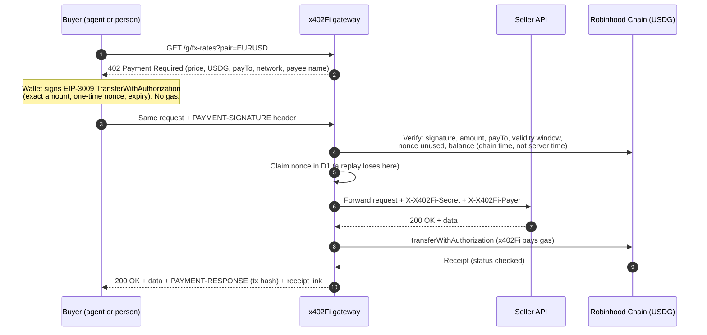

# x402Fi

**The dedicated x402 Finance platform and marketplace on Robinhood Chain.**

x402Fi lets any business sell an API, a data feed, an AI agent or an on-chain product **per request, in dollars**, to people and AI agents, using the open [x402](https://x402.org) payment standard. Buyers pay in **USDG** on **Robinhood Chain** with a single signature: no accounts, no API keys, no invoices, no gas. Sellers keep 100% of every payment, which lands directly in their own wallet.

- **Live:** https://x402fi.dev
- **Marketplace:** https://x402fi.dev/market
- **How x402 works (interactive):** https://x402fi.dev/learn
- **Discovery feed (machine-readable):** https://x402fi.dev/api/discovery/resources
- **Contact:** contact@x402fi.dev · X: [@x402fi_](https://x.com/x402fi_)

> x402Fi is non-custodial software operated by Only Buy Bitcoin LLC. It never holds user funds. See [Terms](https://x402fi.dev/terms), [Privacy](https://x402fi.dev/privacy) and [Disclaimer](https://x402fi.dev/disclaimer).

---

## Contents

1. [Why x402Fi](#why-x402fi)
2. [Features](#features)
3. [How a payment works](#how-a-payment-works)
4. [Architecture](#architecture)
5. [x402 implementation details](#x402-implementation-details)
6. [Pricing modes](#pricing-modes)
7. [Verified Payee (x402 Identity)](#verified-payee-x402-identity)
8. [On-chain settlement: HoodFi name registration](#on-chain-settlement-hoodfi-name-registration)
9. [Security model](#security-model)
10. [Public APIs](#public-apis)
11. [Data model](#data-model)
12. [Project structure](#project-structure)
13. [Local development](#local-development)
14. [Configuration and secrets](#configuration-and-secrets)
15. [Database migrations](#database-migrations)
16. [Deploying](#deploying)
17. [Testing](#testing)
18. [Operations](#operations)
19. [Known traps](#known-traps)
20. [Reference values](#reference-values)
21. [Legal](#legal)

---

## Why x402Fi

HTTP has reserved status code **402 Payment Required** since 1997. x402 finally gives it a precise meaning: a server answers an unpaid request with a machine-readable price, the client signs a payment, retries, and gets the response. That makes **per-request payments** practical for software, and especially for AI agents, which cannot fill in sign-up forms or manage API keys.

x402Fi packages that into a product businesses and institutions can use without writing payment code:

- **For businesses:** paste the URL of an API you already run, set a price, and x402Fi puts the paywall in front of it.
- **For institutions:** every payment is non-custodial, settles on a public chain, comes with a receipt and a transaction hash, and lands in an exportable ledger. Payees can be bound to a signed on-chain name.
- **For developers:** a public x402 facilitator for Robinhood Chain, a Bazaar-style discovery feed, and open protocol details.

## Features

| Area | What it does |
|---|---|
| **No-code paywall** | A gateway at `/g/<listing>/<path>` answers 402 with a price, verifies the buyer's signed USDG authorization, forwards the call to the seller's API and settles **only after the API answers 2xx**. |
| **Multi-endpoint listings** | One listing (project) holds many endpoints, each with its own method, path and pricing: free, fixed, seller-quoted or on-chain contract. |
| **Marketplace** | Searchable listings with categories, price summaries, logos and a live **Try it** button that runs a real payment from the visitor's wallet. |
| **Verified Payee** | Sellers link an x402 Identity (ENS) name. x402Fi checks it with the open `payee-name` verifier and shows a badge only when the name's own records list the service and its payout wallet. |
| **Verified profiles** | Logo, website and X handle are read from the payee name's ENS records (verified ✓). Seller-entered values fill gaps and are labelled "by seller". |
| **On-chain products** | A `contract` pricing mode settles by calling a seller contract (e.g. register a name and deliver it) in **one atomic transaction**. |
| **Ledger and receipts** | Every paid attempt is recorded (settled, not charged, or API error). Each payment has a public receipt page with its transaction hash, and sellers can export a CSV. |
| **Public facilitator** | `/api/facilitator/verify`, `/settle`, `/supported` for anyone building x402 on Robinhood Chain. |
| **Discovery feed** | Bazaar-style JSON of every paid endpoint for agents and indexers (`/api/discovery/resources`), with a readable view at [`/discovery`](https://x402fi.dev/discovery). |
| **Native x402 listings** | Sellers whose endpoint already charges with x402 list it as is: x402Fi reads the price, `payTo` and payee name from their 402 and buyers pay the seller **directly**. x402Fi never proxies, settles or takes a fee on these. |
| **Priors credit records** | Listings show the payout wallet's [Priors](https://priors.trade) record (ERC-8004 agent credit on Robinhood Chain): score, loans repaid, defaults. |
| **HoodFi payee names** | A `*.hoodfi.eth` name, native to Robinhood Chain, can be the payee name: its records are written in one Robinhood Chain transaction, and sellers can register one in the wizard over x402. |
| **Listing wizard** | Five steps: service → price and payout → identity (optional) → connection test → publish. Proxied or native endpoint; ENS or HoodFi payee name, with optional logo, website and X records written in the same transaction. |
| **Dashboard** | Revenue, a 30-day chart, ledger, CSV export, pause, payout rotation, upstream secret rotation, profile and endpoint editing. |
| **Wallet sign-in** | Sign-In with Ethereum (EIP-4361). Works with injected, WalletConnect, email and social wallets (Reown AppKit). |
| **Light and dark themes** | Cream-and-forest design system, phone-first layout. |

Listing is **free** and x402Fi takes **0%**. The only optional paid step in the flow is registering an x402 Identity name (a third-party ENS registrar, paid on Ethereum).

## How a payment works



If the seller's API errors or times out, step 9 never happens: the authorization is never used and the buyer is not charged. The ledger records the failed attempt.

## Architecture

```
                     ┌────────────────────────── Cloudflare ──────────────────────────┐
 Browser / Agent ──▶ │  Worker: Next.js 15 (App Router) via @opennextjs/cloudflare   │
                     │   ├─ pages: /, /market, /market/[slug], /sell/new, /dashboard, │
                     │   │         /learn, /institutions, /developers, /receipt/[id],│
                     │   │         /terms, /privacy, /disclaimer                     │
                     │   ├─ /g/[slug]/[[...path]]   x402 gateway (all methods)       │
                     │   ├─ /api/facilitator/*      public facilitator               │
                     │   ├─ /api/discovery/*        discovery feed                   │
                     │   ├─ /api/rpc, /api/rpc/mainnet  browser RPC proxies          │
                     │   └─ /api/{auth,listings,services,dashboard,payments,logo}    │
                     │  D1 (SQLite, Drizzle)   KV (payee/profile cache, SIWE nonces) │
                     │  Email Routing: contact@x402fi.dev                            │
                     └───────────────┬──────────────────────────────┬────────────────┘
                                     │                              │
                 Robinhood Chain (4663): USDG, settlement     Ethereum mainnet: ENS
                 Alchemy → public RPC → Blockscout RPC        (payee names, profiles)
```

**Stack:** Next.js 15, React 19, TypeScript, Tailwind CSS v4, viem, wagmi, Reown AppKit, Drizzle ORM, Cloudflare Workers + D1 + KV, Vitest. Related on-chain code (the HoodFi registration contract) lives in the [`hoodfi-eth`](https://github.com/RWA-ID) repository (Foundry).

## x402 implementation details

x402Fi implements **x402 version 2**, scheme **`exact`**, on network **`eip155:4663`** (Robinhood Chain), asset **USDG**.

**402 response.** JSON body plus the same object base64-encoded in the `PAYMENT-REQUIRED` header:

```json
{
  "x402Version": 2,
  "resource": { "url": "https://x402fi.dev/g/demo-quote", "description": "…", "mimeType": "application/json" },
  "accepts": [{
    "scheme": "exact",
    "network": "eip155:4663",
    "amount": "10000",
    "asset": "0x5fc5360D0400a0Fd4f2af552ADD042D716F1d168",
    "payTo": "0x837Fa2d033f1F7275452D780a5E54Eda903C1330",
    "maxTimeoutSeconds": 120,
    "extra": { "name": "Global Dollar", "version": "1" }
  }],
  "extensions": { "payee-name": { "info": { "name": "hoodfi.402api.eth" } } }
}
```

**Payment header.** The client retries with `PAYMENT-SIGNATURE` (v2) or `X-PAYMENT` (v1 name, accepted) containing base64 JSON:

```json
{
  "x402Version": 2,
  "accepted": { "...": "the chosen entry from accepts" },
  "payload": {
    "signature": "0x…",
    "authorization": { "from": "0x…", "to": "0x…", "value": "10000", "validAfter": "0", "validBefore": "1794…", "nonce": "0x…32 bytes" }
  }
}
```

**Success.** `PAYMENT-RESPONSE` and `X-PAYMENT-RESPONSE` carry base64 `{ success, transaction, network, payer }`; `X-X402Fi-Receipt` links the receipt page.

**USDG EIP-712 domain.** `{ name: "Global Dollar", version: "1", chainId: 4663, verifyingContract: 0x5fc5…d168 }`. The token has **no `version()` getter**; `"1"` was confirmed by reproducing its `DOMAIN_SEPARATOR()` on-chain. Signatures are EIP-3009 `TransferWithAuthorization` with v/r/s (EOA wallets).

**Verification** (`src/lib/x402/facilitator.ts`): x402 version, scheme, network, asset, `payTo` and `to` match, `value` equals the price exactly, `validBefore` ≥ chain time + 6 s, `validAfter` ≤ chain time, signature recovers to `from` (`verifyTypedData`, which also supports ERC-1271/6492), nonce unused (`authorizationState`), and balance ≥ value. A failed chain read returns **503 retry**, never a denial.

## Pricing modes

Each endpoint (a "service" inside a listing) has a path prefix, a method and one pricing mode. Requests route to the live endpoint with the same method and the **longest matching path prefix**.

| Mode | Price comes from | Settlement | Who can enable |
|---|---|---|---|
| `free` | — | Forwarded without payment, no ledger row | Seller |
| `fixed` | `priceAtomic` per call | USDG transfer to the listing's payout wallet, after the API returns 2xx | Seller |
| `quote` | Seller API: `GET {upstream}{quotePath}{rest}` → `{"price":"5.00"}` or `{"amount":"5000000"}`, capped by a published ceiling, re-quoted on the paid request | Same as fixed | Seller |
| `contract` | On-chain `quote(label)` on a "label registrar" contract | The contract call itself (`registerWithAuthorization`), atomic | x402Fi admin (x402Fi pays the gas) |
| `native` | The seller's own 402, read by an unpaid probe (cached 10 min; re-checked when saved) | **None by x402Fi**: the buyer pays the seller directly; the gateway answers `307` to the seller's URL | Seller (signed in) |

**Minimum price: $0.01** for the modes x402Fi settles (`fixed`, `quote`). Settling one payment costs x402Fi roughly $0.006 to $0.007 of gas on Robinhood Chain (measured on the first live payment), so a cent covers it. Enforced in the wizard, the endpoint editor, seller quotes and the API (`MIN_PRICE_ATOMIC`).

## Verified Payee (x402 Identity)

x402Fi integrates the **x402 Identity Hub** and its **`payee-name`** extension ([spec](https://github.com/RWA-ID/x402-Identity/blob/main/specs/extensions/payee-name.md)):

1. In the wizard's Identity step, a seller mints a name such as `yourco.402api.eth` with the embedded [`@x402identity/widget-react`](https://www.npmjs.com/package/@x402identity/widget-react). x402Fi sets **no platform fee** on it.
2. x402Fi writes the payee records in one Ethereum transaction (existing origins are kept):
   - `org.x402.origins` += `https://x402fi.dev`
   - address record for Robinhood Chain, coin type `0x80000000 | 4663` = **`2147488311`**, = the payout wallet
   - optionally `org.x402.payto` for extra payees, e.g. `eip155:4663:<contract>` for contract endpoints
3. The 402 carries `extensions.payee-name.info.name`, and the listing page runs [`@x402identity/payee`](https://www.npmjs.com/package/@x402identity/payee) `verifyPayee` (cached 10 minutes in KV). The badge is tri-state: **Verified**, **not confirmed** (with the reason) or **couldn't check right now**. A failed read is never shown as a failure.

Profile fields are read from the same name: `avatar`, `url` (or `website`), `com.twitter` (or `com.x`, `X`, `x`, `twitter`). ENS keys are case-sensitive. The wizard can write `avatar`, `url` and `com.twitter` in the same transaction as the payee records.

Writing payee records **keeps** any existing `org.x402.origins` and `org.x402.payto` entries (widget-core's builder always rewrites `org.x402.payto`, so x402Fi merges first).

**Native listings** are checked against the seller's own origin, because that is the origin buyers contact.

### HoodFi names as payee names

`*.hoodfi.eth` names live in HoodFi's L2Registry on Robinhood Chain (`0xf2bABA012244bdD7445129597350054E1B3aEe5C`), which inherits ENS's `TextResolver`, `AddrResolver` and `Multicallable`. Only the name's owner (or an approved address) sets its records. HoodFi's CCIP gateway serves any record on Ethereum, so the standard `payee-name` verifier works unchanged.

- The wizard's **Use a HoodFi name** option writes `org.x402.origins`, the Robinhood Chain address record, `org.x402.payto` (merged) and optional profile records in **one `multicall` on Robinhood Chain** (gas in ETH on 4663). It checks ownership first. A simulated write succeeds from the owner and reverts from anyone else.
- A seller without a name can register one in place, from $3 in USDG over x402, through the HoodFi listing.
- The verifier's informational `parent_can_control` reads `true` for these names because it is computed from Ethereum mainnet's NameWrapper, where L2 subnames do not exist. It does not describe control on Robinhood Chain, so x402Fi does not surface it.

## On-chain settlement: HoodFi name registration

The first project on x402Fi is **HoodFi Names** (`*.hoodfi.eth` names on Robinhood Chain). Its listing has two endpoints:

| Endpoint | Pricing |
|---|---|
| `GET /g/hoodfi-names/owner/<wallet>/names`: every HoodFi name a wallet holds | free |
| `POST /g/hoodfi-names/register/<name>`: registers `<name>.hoodfi.eth` for the payer | `contract`, $3 (4+ chars) to $15 (1 char) |

An x402 buyer only signs, but HoodFi's registrar mints to whoever sends the transaction. **`HoodfiX402Registrar`** ([`0x64A6439a05aa4c91c3ACE97842a98148888A2534`](https://robinhoodchain.blockscout.com/address/0x64A6439a05aa4c91c3ACE97842a98148888A2534), source verified on Sourcify, owned by the HoodFi Safe) bridges the gap in **one transaction**:

1. pull exactly the quoted price from the buyer with their EIP-3009 signature (`to` = the contract);
2. pay the live registrar and register the name (minted to the contract);
3. point the name's address records (coin types 60 and 2147488311) at the buyer;
4. transfer the NFT to the buyer.

Any failure reverts all four, so the buyer is never charged without the name. The name always goes to the address that signed. The contract keeps no margin and is never a registrar. Measured gas: about 350 to 400k (≈ $0.02 to $0.05). The first registration through x402 was `dominic.hoodfi.eth`.

## Security model

- **Non-custodial.** Payments go buyer → seller (or buyer → seller contract) under the buyer's own signature. The settlement wallet only holds ETH for gas and never receives USDG.
- **Charge only for answers.** Fixed and quoted endpoints settle after the upstream returns 2xx; contract endpoints are atomic.
- **Replay protection.** The authorization nonce is claimed in D1 under a unique index **before** the upstream is called, and USDG's `authorizationState` rejects reuse on-chain.
- **Upstream secret.** Every forwarded paid call carries `X-X402Fi-Secret` (per listing, rotatable) so sellers can reject calls that bypass the paywall, plus `X-X402Fi-Payer`.
- **SSRF guard** (`src/lib/ssrf.ts`). https only, port 443, no credentials, no `localhost`/`.internal`/etc. Private, link-local, CGNAT, documentation and multicast ranges are blocked in **every notation**, including IPv4-mapped (`::ffff:127.0.0.1`), IPv4-compatible and NAT64 IPv6. **Every A/AAAA answer** is resolved over DoH before fetching, redirects are not followed, and requests time out. Workers also run with `global_fetch_strictly_public`.
- **Native probes** are unpaid, SSRF-guarded, time-limited, available only to signed-in sellers, and never send a payment header.
- **Contract endpoints are admin-only** and capped at 600k gas per settlement, so nobody can point x402Fi's gas at an expensive contract.
- **Logos are proxied server-side**, sniffed by magic bytes (PNG, JPEG, GIF, WebP only; no SVG), capped at 1 MB and served with `content-security-policy: default-src 'none'; sandbox` and `nosniff`. Viewing a listing never contacts the seller's host from the visitor's browser.
- **Profile links** are https-only and rendered `rel="noopener noreferrer nofollow ugc"`; X links must be x.com/twitter.com profiles.
- **CSV export** neutralizes spreadsheet formula injection.
- **Sessions** are HMAC-signed, `httpOnly`, `secure`, `sameSite=lax` cookies issued after SIWE verification with one-time KV nonces.
- **Browser RPC proxies** allow only read methods and `eth_sendRawTransaction`.

## Public APIs

### Gateway

`{METHOD} https://x402fi.dev/g/<slug>/<path>`. Standard x402 v2 as above. Status codes: `402` (pay), `200` (paid response), `307` (native endpoint: redirect to the seller's own URL, which the buyer pays directly), `400` (missing name for contract endpoints), `404` (unknown listing or path; lists the endpoints), `405` (wrong method; `Allow` header), `409` (name unavailable, with reason), `413` (body over 1 MB), `429` (seller's daily cap), `502` (upstream error; not charged), `503` (chain unreachable or paused; retry, not charged).

### Facilitator

| Endpoint | Body | Returns |
|---|---|---|
| `POST /api/facilitator/verify` | `{ paymentPayload, paymentRequirements }` | `{ isValid, payer }` or `{ isValid:false, invalidReason }` |
| `POST /api/facilitator/settle` | same | `{ success, transaction, network, payer }` |
| `GET /api/facilitator/supported` | — | `{ kinds:[{x402Version:2, scheme:"exact", network:"eip155:4663"}], extensions:["payee-name"] }` |

### Discovery

`GET /api/discovery/resources` returns one item per paid live endpoint: `resource`, `accepts`, `metadata` (`name`, `description`, `category`, `method`, `pricing`, `priceIsCeiling`, `payeeName`, `listing`; contract endpoints add `settlement: "contract"`, `contract`, `pathTemplate`; native endpoints add `settlement: "direct"`, with `resource` being the seller's own URL and `accepts` read from its live 402). Readable view: `/discovery`.

### Listing helpers (signed-in sellers)

`POST /api/listings/probe-native` `{ url, method, body }` reads a seller's own x402 endpoint once, unpaid, and returns its USDG / Robinhood Chain price, `payTo`, payee name and offered networks.

## Data model

D1 (SQLite) via Drizzle, schema in `src/db/schema.ts`, migrations in `migrations/`.

| Table | Purpose |
|---|---|
| `sellers` | Wallets that signed in (checksummed address). |
| `listings` | A project: name, summary, description, category, upstream base URL, payout wallet, payee name, upstream secret, daily cap, profile (logo, website, X), status. |
| `services` | Endpoints of a listing: method, path, pricing (`free`/`fixed`/`quote`/`contract`/`native`), price, quote path, ceiling, contract config, examples (incl. the JSON body used to probe a native POST endpoint), order, status. |
| `payments` | The ledger: listing, endpoint, payer, payee, amount, unique nonce, status (`pending`/`settled`/`settle_failed`/`upstream_failed`), tx hash, error, path, upstream status, latency. |

KV stores SIWE nonces (10 min), payee verdicts, ENS profiles, native-endpoint probes and Priors records (10 min each; failures 60 s).

## Project structure

```
src/
  app/
    page.tsx                     landing page
    learn/ institutions/ developers/ discovery/ terms/ privacy/ disclaimer/
    market/                      marketplace + listing pages (TryIt)
    sell/new/                    5-step listing wizard (proxied or native; ENS or HoodFi payee name)
    dashboard/                   seller dashboard + endpoint editor
    receipt/[id]/                public receipts
    g/[slug]/[[...path]]/        x402 gateway route
    api/                         facilitator, discovery, auth, listings (+ probe-native), services, dashboard, payments CSV, logo, rpc
  components/                    header, footer, handshake explainer, cards, payee + Priors badges, wallet button, legal layout
  db/schema.ts                   Drizzle schema
  lib/
    chains.ts                    Robinhood Chain, USDG, coin type
    x402/                        types, encoding, money, requirements, EIP-712, facilitator, contract settlement, native 402 parser
    gateway/                     handler + pure routing/quote helpers
    server/                      env bindings, chain clients, session, queries, payee, profile, discovery, native probe, Priors, validation
    client/                      wagmi/AppKit config, SIWE session hook, payee-record writers (ENS on Ethereum, HoodFi on Robinhood Chain)
    ssrf.ts  profile.ts  priors.ts
migrations/                      D1 SQL migrations
scripts/                         seed-demo.mjs, seed-hoodfi.mjs, pay-demo.mjs
test/                            Vitest unit tests
```

## Local development

Requirements: Node 22, npm, a Cloudflare account with Wrangler logged in.

```sh
npm install
cp .dev.vars.example .dev.vars        # fill in the values (see below)
npm run db:migrate:local              # apply migrations to the local D1
node scripts/seed-demo.mjs 0xYourPayout   # optional: the $0.01 demo listing
npm run dev                           # http://localhost:3000
```

`next dev` gets D1/KV bindings through `initOpenNextCloudflareForDev()` in `next.config.ts`. To run the real Worker runtime locally: `npm run preview`.

## Configuration and secrets

Secrets live in Cloudflare (`wrangler secret put NAME`) and locally in **`.dev.vars`** (gitignored). **Never** declare a secret's name under `vars` in `wrangler.jsonc`: a plain var shadows the secret of the same name.

| Name | Required | Purpose |
|---|---|---|
| `SESSION_SECRET` | yes | HMAC key for session cookies (64 random hex). |
| `SETTLEMENT_PRIVATE_KEY` | yes | Settlement wallet: pays gas to submit payments. Holds ETH on Robinhood Chain only. |
| `ROBINHOOD_RPC_URL` | strongly recommended | Dedicated Robinhood Chain RPC (e.g. Alchemy `robinhood-mainnet`). The public RPC rate-limits Cloudflare Workers. |
| `MAINNET_RPC_URL` | recommended | Ethereum RPC for ENS reads (server-side key, no domain allowlist). |
| `NEXT_PUBLIC_REOWN_PROJECT_ID` | optional | Reown/WalletConnect project ID (a default is built in). |

Bindings (`wrangler.jsonc`): `DB` (D1 `x402fi`), `KV`, `ASSETS`. Custom domain `x402fi.dev`; `workers_dev` stays enabled.

## Database migrations

```sh
npm run db:generate          # drizzle-kit: SQL from src/db/schema.ts
npm run db:migrate:local
npm run db:migrate:remote    # production D1
```

Apply additive migrations **before** deploying code that uses them. Data migrations (like `0001_services.sql`, which turned each listing into its first endpoint) are appended to the generated SQL.

## Deploying

```sh
npm run deploy     # opennextjs-cloudflare build && deploy
npm run upload     # build + upload a new version without promoting (preview URL)
```

Check the deploy log for `Current Version ID`. Static chunks are served with `cache-control: public, max-age=31536000, immutable` via `public/_headers`.

## Testing

```sh
npm test           # Vitest
npm run typecheck
```

Unit tests cover the money math, the 402 shape, verification against signed authorizations (wrong amount, payee, expiry, reuse, balance, tampering, RPC failure = retryable), the SSRF guard (every blocked notation plus public controls), endpoint routing and quotes, label parsing, the price minimum, profile parsing, native 402 parsing (v1 and v2, header and body) and Priors record parsing.

End-to-end checks that need no money: send a payment signed by a throwaway wallet with **no funds**. A healthy gateway answers `402 insufficient_funds`; a `503` means the chain was unreachable. A real paid test: `node --dns-result-order=ipv4first scripts/pay-demo.mjs` (run by the wallet owner; refuses anything above $0.01).

## Operations

- **Settlement wallet:** keep a small ETH balance on Robinhood Chain. One payment costs ≈ 0.0000022 ETH; a HoodFi registration ≈ 0.000007 ETH.
- **Gas economics:** x402Fi pays settlement gas so buyers need only USDG. The $0.01 minimum keeps each payment above its gas cost; batch settlement is the long-term path for sub-cent prices.
- **Pausing:** sellers can pause a listing or a single endpoint from the dashboard. Endpoints with payments are paused rather than deleted so receipts stay valid.
- **Adding a contract endpoint** (admin): insert a `services` row with `pricing = 'contract'`, a ceiling and `contract_config = {"address":"0x…","kind":"label-registrar","labelSuffix":".example.eth"}`. Add `org.x402.payto = eip155:4663:<contract>` to the listing's payee name.
- **Email:** `contact@x402fi.dev` forwards through Cloudflare Email Routing.

## Known traps

| Trap | What happens | Fix in this repo |
|---|---|---|
| Robinhood public RPC from Workers | Rate-limited per IP across Cloudflare's shared egress: ~5 of 6 verifications failed | `ROBINHOOD_RPC_URL` first, public and Blockscout fallbacks, retries, `rank: false` |
| Robinhood RPC CORS | POST responses carry a duplicated `access-control-allow-origin: *,*`; browsers drop them | Browser RPC goes through `/api/rpc` |
| USDG has no `version()` | Wrong domain = every signature "invalid" | Domain `"Global Dollar"`, `"1"`, confirmed against `DOMAIN_SEPARATOR()` |
| Drizzle correlated subqueries | Interpolated columns render unqualified; a per-listing count silently returned 0 | Explicit aliases in raw SQL (`src/lib/server/queries.ts`) |
| `wrangler tail` | Delivered no events during debugging | 503 bodies carry a `detail` naming the failing step |
| ENSv2 `getEnsResolver` | Returns a shared shim resolver, not the name's real one | Read the registry's `resolver(node)` when the resolver itself matters |
| `createAppKit` behind `typeof window` | `useAppKit()` throws during prerender | Called at module scope (`src/components/Providers.tsx`) |
| Optional wallet SDK imports | `@x402/*` and `mppx` deep imports break the webpack build | Aliased to `false` in `next.config.ts` |
| next/font variables | Defined on `<body>`, `:root` tokens can't see them | Font variables on `<html>` |
| Node on IPv6-broken networks | `fetch` hangs connecting over IPv6 | `node --dns-result-order=ipv4first` for scripts |

## Reference values

| | |
|---|---|
| Robinhood Chain | chain ID `4663`, CAIP-2 `eip155:4663`, explorer https://robinhoodchain.blockscout.com |
| USDG | `0x5fc5360D0400a0Fd4f2af552ADD042D716F1d168`, 6 decimals, issued by Paxos |
| ENS coin type (Robinhood Chain) | `2147488311` |
| x402Fi settlement wallet | `0x79678f054624B50B6d2fB7b43D45c9402181ABEA` (gas only) |
| HoodfiX402Registrar | `0x64A6439a05aa4c91c3ACE97842a98148888A2534` |
| HoodFi registrar | `0x56be5565acc823f4195c2cf3b9046C083633209a` |
| HoodFi L2 registry | `0xf2bABA012244bdD7445129597350054E1B3aEe5C` |
| x402 Identity registrar (Ethereum) | `0xeb9e9ea385fe28b51a3f9a7d93fb893e0a1f9633` |

## Legal

x402Fi is operated by **Only Buy Bitcoin LLC** under the laws of Delaware, USA. It is software, not a bank, money transmitter, payment processor, exchange or custodian. USDG is issued by Paxos; x402Fi is not affiliated with Paxos, Robinhood, ENS, Coinbase or the x402 project.

- Terms of Service: https://x402fi.dev/terms
- Privacy Policy: https://x402fi.dev/privacy
- Disclaimer: https://x402fi.dev/disclaimer

## License

Apache-2.0, see [LICENSE](LICENSE) and [NOTICE](NOTICE). © 2026 Only Buy Bitcoin LLC. Contact: contact@x402fi.dev
